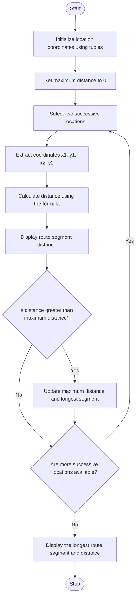

### Problem Statement
The program should calculate the distance between consecutive locations, display the distance of each route segment, and identify the longest route segment by comparing the calculated distances.

### Algorithm
1. Start the program.
2. Initialize the route coordinates using tuples.
3. Create an empty list to store segment distances.
4. Select two consecutive points.
5. Calculate the distance between the points using the Euclidean distance formula.
6. Store and display each segment distance.
7. Repeat until all consecutive points are processed.
8. Find and display the longest segment.
9. Stop the program.

### Flowchart

### Code
points = [(0, 0), (3, 4), (6, 4)]

distances = []

for i in range(len(points) - 1):

    x1, y1 = points[i]
    
    x2, y2 = points[i + 1]
    
    d = ((x2 - x1)**2 + (y2 - y1)**2)**0.5
    
    distances.append(d)
    
    print("Segment", i + 1, "distance:", d)
    
print("Longest segment:", max(distances))

### Sample input
points = [(0, 0), (3, 4), (6, 4)]

### Sample output
Segment 1 distance: 5.0

Segment 2 distance: 3.0

Longest segment: 5.0

