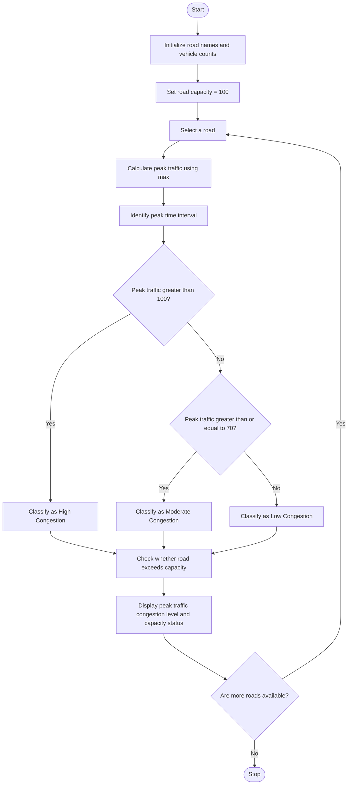

### Problem Statement
To develop a Python program to analyze traffic flow across multiple roads during different time intervals. The program should calculate the peak traffic for each road, identify the time interval with the highest number of vehicles, classify congestion levels as low, moderate, or high, and identify roads where the number of vehicles exceeds the specified road capacity.

### Algorithm:
1. Start.
2. Initialize the list of roads as Main, Park, and Lake.
3. Store the vehicle counts for each road at different time intervals.
4. Set the road capacity to 100 vehicles.
5. Repeat for each road:
   - Find the maximum vehicle count using max().
   - If the peak count is greater than 100, classify the traffic as High.
   - Otherwise, classify the traffic as Normal.
6. Display the road name, peak vehicle count, and traffic level.
7. Stop.

### Flowchart

### Code
roads = ["Main", "Park", "Lake"]

counts = [[40, 80, 120], [30, 45, 60], [50, 90, 110]]

capacity = 100

for i in range(len(roads)):

    peak = max(counts[i])
    
    level = "High" if peak > capacity else "Normal"
    
    print(roads[i], "peak:", peak, level)'''

### Sample Input
Roads = ["Main", "Park", "Lake"]

Vehicle Counts:
Main Road: 40, 80, 120
Park Road: 30, 45, 60
Lake Road: 50, 90, 110

Capacity = 100

### Sample Output
Main peak: 120 High\n
Park peak: 60 Normal\n
Lake peak: 110 High

