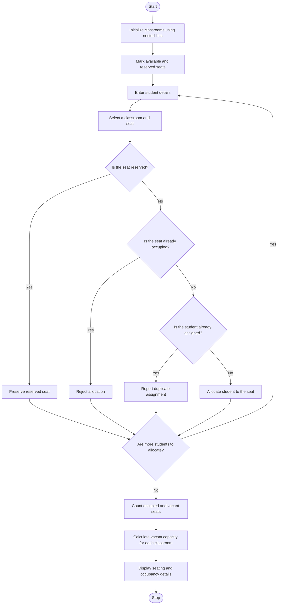

### Problem Statement
To develop a Python program using nested lists to represent multiple classrooms and their seating positions. The program should allocate students to available seats, preserve reserved seats, detect duplicate student assignments, and calculate the number of vacant seats in each classroom. The program helps manage classroom seating efficiently and prevents seat allocation errors.

### Algorithm:
1.Start the program.
2. Initialize the classroom seating arrangement.
3.Create a list of students waiting for seats.
4. Check each seat in every classroom.
5. If a seat is empty and a student is available, assign the student to that seat.
6. Display the updated seating arrangement.
7. Count the remaining empty seats.
8. Stop the program.
### Flowchart

### Code
seats = [["A", "RESERVED", ""], ["B", "", "C"]]

students = ["Ravi", "Maya"]

i = 0

while i < len(seats):
    
    j = 0
    
    while j < len(seats[i]):
        
        if seats[i][j] == "":
            
            if students:
        
                seats[i][j] = students.pop(0)
    
        j += 1

    i += 1

print(seats)

print("Vacant:", sum(row.count("") for row in seats))

### Sample Input
Classroom Seats:

[
    
    ["A", "RESERVED", ""],

    ["B", "", "C"]
]

Students to Allocate:

["Ravi", "Maya"]

### Sample Output
[['A', 'RESERVED', 'Ravi'], ['B', 'Maya', 'C']]

Vacant: 0

