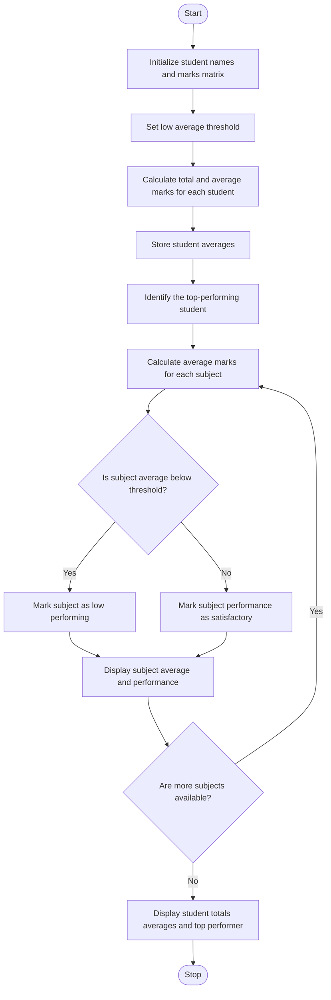

### Problem Statement
To develop a Python program to analyze a matrix of student marks across multiple subjects. The program should calculate the total and average marks of each student (row-wise), calculate the average marks for each subject (column-wise), identify the top-performing student, and detect subjects with low average performance. This analysis helps evaluate student performance and identify subjects that require improvement.

### Algorithm
1. Start the program.
2. Initialize the marks of students in different subjects.
3. Store the names of the students.
4. Calculate and display each student's total marks.
5. Calculate the average marks for each subject.
6. Identify the student with the highest total marks.
7. Display the results.
8. Stop the program.

### flowchart

### Code
marks = [[80, 70, 90], [60, 75, 65], [95, 88, 92]]
names = ["Ana", "Ben", "Cia"]
for i in range(len(marks)):
    print(names[i], "total =", sum(marks[i]))
for j in range(len(marks[0])):
    total = 0
    for i in range(len(marks)):
        total += marks[i][j]
    print("Subject", j + 1, "average =", total / len(marks))
print("Top student:", names[marks.index(max(marks, key=sum))])

### Sample Input
Student Names: ["Ana", "Ben", "Cia"]

Student Marks:
[
    [80, 70, 90],
    [60, 75, 65],
    [95, 88, 92]
]

### Sample Output
Ana total = 240
Ben total = 200
Cia total = 275
Subject 1 average = 78.33333333333333
Subject 2 average = 77.66666666666667
Subject 3 average = 82.33333333333333
Top student: Cia

