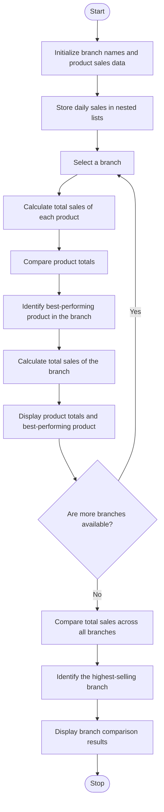

### Problem Statement
To develop a Python program using nested lists to store product sales data across multiple branches and days. The program should calculate the total sales of each product, compare the total sales of different branches, and identify the best-performing product in each branch. This analysis helps businesses understand product performance, compare branch sales, and identify the products generating the highest sales.

### Algorithm
1. Start the program.
2. Initialize branch names, product names, and sales data.
3. Calculate the total sales for each branch.
4. Find the product with the highest sales in each branch.
5. Display the branch total and best-selling product.
6. Stop the program.

### Flowchart

### Code
branches = ["East", "West"]

products = ["Pen", "Book", "Bag"]

sales = [[10, 20, 5], [15, 12, 8]]

for i in range(len(branches)):

    print(branches[i], "total:", sum(sales[i]))
    
    best = sales[i].index(max(sales[i]))
    
    print("Best product:", products[best])

### Sample Input
Branches = ["East", "West"]

Products = ["Pen", "Book", "Bag"]

Sales:

East Branch = [10, 20, 5]

West Branch = [15, 12, 8]

### Sample Output
East total: 35

Best product: Book

West total: 35

Best product: Pen

