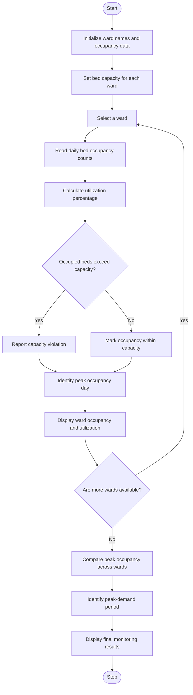

### Problem Statement
To develop a Python program using nested lists to monitor hospital bed occupancy across multiple wards and days. The program should calculate bed utilization percentages, detect capacity violations when occupied beds exceed the ward's capacity, and identify peak-demand periods based on the highest number of occupied beds. This analysis helps hospitals monitor bed availability, manage resources efficiently, and identify periods of high patient demand.

### Algorithm
1. Start the program.
2. Initialize ward names, daily patient counts, and ward capacities.
3. Calculate the occupancy percentage for each day.
4. Display the ward name and occupancy percentage.
5. Check whether the number of patients exceeds the ward capacity.
6. Display a warning if the capacity is exceeded.
7. Stop the program.

### Flowchart

### Code
wards = ["A", "B"]

beds = [[8, 10, 9], [5, 7, 6]]

capacity = [10, 8]

for i in range(len(wards)):

    for day in range(len(beds[i])):
    
        percent = beds[i][day] / capacity[i] * 100
        
        print(wards[i], "day", day + 1, percent, "%")
        
        if beds[i][day] > capacity[i]:
        
            print("Capacity exceeded!")

### Sample Input
Wards = ["A", "B"]

Bed Occupancy:

Ward A = [8, 10, 9]

Ward B = [5, 7, 6]

Capacity = [10, 8]

### Sample Output
A day 1 80.0 %

A day 2 100.0 %

A day 3 90.0 %

B day 1 62.5 %

B day 2 87.5 %

B day 3 75.0 %

