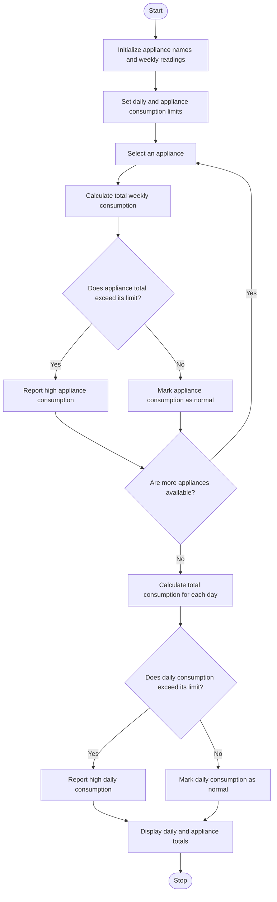

### Problem Statement
To develop a Python program using nested lists to analyze appliance-wise electricity consumption over seven days. The program should store daily electricity readings for multiple appliances, calculate the total consumption of each appliance for the week, calculate the total electricity consumption for each day, and identify appliances or days where electricity consumption exceeds specified limits. This analysis helps monitor electricity usage, identify high-consumption appliances, and promote efficient energy management.

### Algorithm
1. Start the program.
2. Initialize appliance names and their daily electricity consumption.
3. Set the weekly consumption limit.
4. Calculate the total weekly units for each appliance.
5. Compare the total with the given limit.
6. Display the total units and show a warning if the limit is exceeded.
7. Stop the program.

### Flowchart

### Code
appliances = ["Fan", "AC", "Light"]
units = [[2, 2, 3, 2, 2, 1, 2],[5, 6, 5, 7, 6, 5, 4],[1, 1, 1, 1, 1, 1, 1]]
limit = 35
for i in range(len(appliances)):
    total = sum(units[i])
    print(appliances[i],"weekly units:", total)
    if total > limit:
        print("Above limit")

### Sample Input
appliances = ["Fan", "AC", "Light"]

units = [
    [2, 2, 3, 2, 2, 1, 2],
    [5, 6, 5, 7, 6, 5, 4],
    [1, 1, 1, 1, 1, 1, 1]
]

limit = 35

### Sample Output
Fan weekly units: 14
AC weekly units: 38
Above limit
Light weekly units: 7
