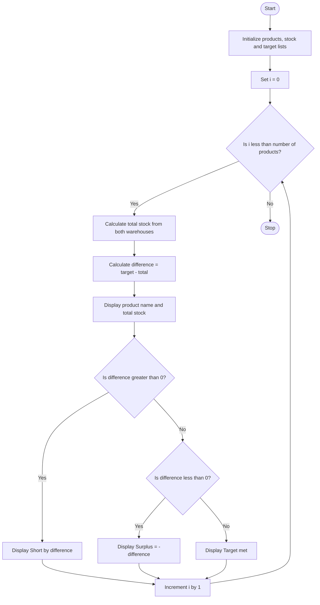

### Problem Statement
Write a Python program using nested lists to compare the quantities of different products stored in multiple warehouses. The program should calculate the total quantity of each product across all warehouses, compare the available stock with the specified stock targets, identify shortages and surpluses, and calculate the number of units that need to be transferred between warehouses to meet the stock targets. Finally, display the stock status and the required transfers.

### Algorithm
1. Start the program.
2. Initialize product names, stock quantities in two warehouses, and target quantities.
3. Calculate the total stock of each product.
4. Find the difference between the target and the available stock.
5. If the difference is positive, display the shortage.
6. If the difference is negative, display the surplus.
7. Otherwise, display that the target is met.
8. Stop the program.

### Flowchart

### Code
products = ["Pen", "Book", "Bag"]
stock = [[20, 10], [5, 15], [8, 4]]  # warehouse 1, warehouse
target = [25, 25, 15]
for i in range(len(products)):
    total = stock[i][0] + stock[i][1]
    difference = target[i] - total
    print(products[i], "stock:", total)
    if difference > 0:
        print("Short by", difference)
    elif difference < 0:
        print("Surplus", -difference)
    else:
        print("Target met")

### Sample Input
products = ["Pen", "Book", "Bag"]

stock = [
    [20, 10],
    [5, 15],
    [8, 4]
]

target = [25, 25, 15]

### Sample Output
Pen stock: 30
Surplus 5
Book stock: 20
Short by 5
Bag stock: 12
Short by 3

