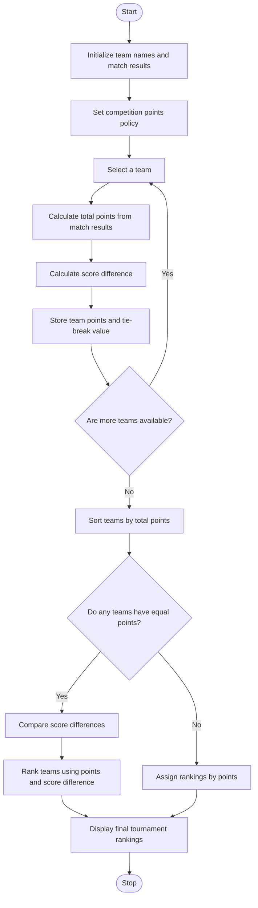

### Problem Statement
Write a Python program using nested lists to store sports tournament match results and team scores. Calculate the total points earned by each team based on the competition policy. Determine tie-break values, such as the total score or score difference, when teams have equal points. Rank the teams according to the specified rules and display the final tournament rankings.

### Algorithm
1. Start the program.
2. Initialize the team names, number of wins, and number of draws.
3. Calculate each team's points using 3 points per win and 1 point per draw.
4. Combine the points and team names.
5. Sort the teams in descending order of points.
6. Display the team rankings and points.
7. Stop the program.
   
### Flowchart

### Code
teams = ["Tigers", "Lions", "Eagles"]
wins = [3, 2, 3]
draws = [1, 2, 0]
points = []
for i in range(len(teams)):
    points.append(wins[i] * 3 + draws[i])
ranking = sorted(zip(points, teams), reverse=True)
for score, team in ranking:
    print(team, score, "points")

### Sample input
teams = ["Tigers", "Lions", "Eagles"]
wins = [3, 2, 3]
draws = [1, 2, 0]

### Sample output
Tigers 10 points
Lions 8 points
Eagles 9 points

