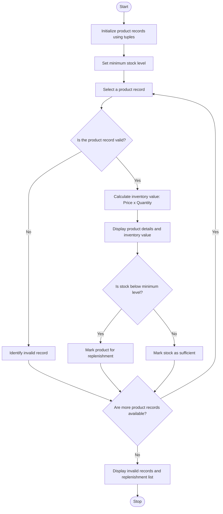

### Problem Statement
The program should examine each product record to detect invalid data, such as negative prices or negative stock quantities. It should calculate the total inventory value of each valid product by multiplying its price by its stock quantity. The program should also identify products that require replenishment when their stock quantity falls below a specified minimum level. Finally, display the valid product details, invalid records, inventory values, and products that need replenishment.

### Algorithm
1. Start the program.
2. Initialize product codes, prices, and stock quantities using tuples.
3. Read each product record.
4. Check whether the price or stock quantity is negative.
5. If either value is negative, display an invalid record message.
6. Otherwise, calculate and display the product value.
7. If the stock quantity is less than 3, display a replenishment message.
8. Stop the program.

### Flowchart

### Code
items = [("P1", 20, 5), ("P2", -3, 4), ("P3", 50, 0)]
for code, price, stock in items:
    if price < 0 or stock < 0:
        print(code, "invalid record")
    else:
        print(code, "value:", price * stock)
        if stock < 3:
            print(code, "needs replenishment")

### Sample input
items = [
    ("P1", 20, 5),
    ("P2", -3, 4),
    ("P3", 50, 0)
]

### Sample output
P1 value: 100
P2 invalid record
P3 value: 0
P3 needs replenishment

